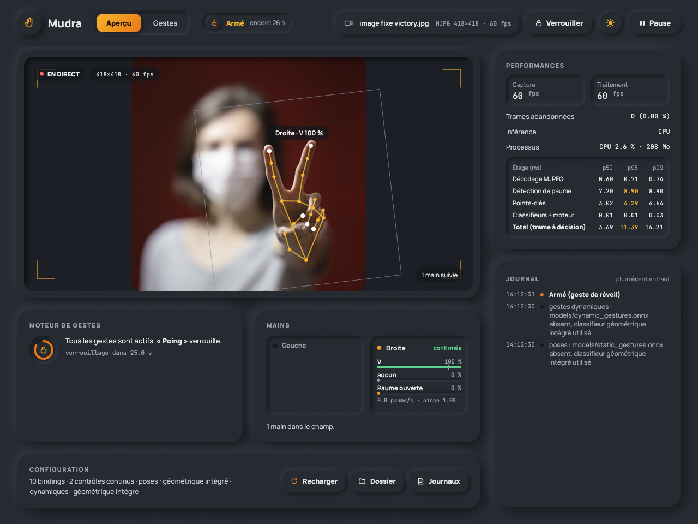

# Mudra

Piloter son PC Windows par des gestes de la main, via la webcam, en temps réel.
Application en Rust ; entraînement des modèles en Python, hors ligne uniquement.



Mudra tourne dans la zone de notification. Une paume ouverte maintenue un
instant « arme » le moteur ; un pouce levé monte alors le volume, un V fait une
capture d'écran, un balayage change de piste. Un poing verrouille. Rien n'est
envoyé sur le réseau et aucune image n'est écrite sur le disque.

Ce dépôt est un **prototype fonctionnel** du
[cahier des charges](docs/cahier-des-charges.md) (dont le nom de travail était
« Gestura »). Ce qui est fait, mesuré, ou encore à valider est listé dans
[État du prototype](#état-du-prototype).

## Installation

Prérequis : Windows 10/11 x64, [Rust stable](https://rustup.rs) avec la cible
MSVC (Visual Studio Build Tools : MSVC + Windows SDK). Python n'est nécessaire
que pour entraîner tes propres classifieurs ([uv](https://docs.astral.sh/uv/)).

```powershell
# 1. Modèles de vision MediaPipe Hands (ONNX, Apache 2.0), vérifiés par SHA-256
powershell -ExecutionPolicy Bypass -File scripts\fetch-models.ps1

# 2. Compilation (binaire optimisé pour cette machine : target-cpu=native)
cargo build --release

# 3. Vérifier la caméra, puis lancer
target\release\mudra.exe devices
target\release\mudra.exe
```

Au premier lancement, `%APPDATA%\Mudra\config.toml` est créé à partir de
[config/default.toml](config/default.toml). Pense à y mettre le nom de ta
caméra (`camera.device`) si ce n'est pas une Logitech StreamCam.

## Utilisation

| État | Icône | Ce qui est reconnu |
|---|---|---|
| Pause | grise | rien ; la caméra est libérée (voyant éteint) |
| Verrouillé | anneau clair | seulement le geste de réveil |
| Armé | bleue | tous les gestes ; retour à Verrouillé après 4 s sans action |
| Continu | verte | un contrôle continu (volume, souris) suit la main |

Gestes livrés par défaut (Annexe B du cahier des charges) :

| Geste | Action par défaut |
|---|---|
| Paume ouverte, 600 ms | réveil : Verrouillé → Armé |
| Poing | verrouiller |
| Pouce levé / baissé | volume +5 % / −5 %, répété tant que la pose est tenue |
| V (index + majeur) | capture du moniteur actif dans `Images\Mudra`, copiée dans le presse-papiers |
| Rock (index + auriculaire) | lancer un programme (Bloc-notes par défaut : à remplacer) |
| Trois doigts | afficher le bureau (Win+D) |
| Pincement maintenu | volume continu : monter ou descendre la main |
| Index tendu | souris : le curseur suit l'index, pincer pour cliquer |
| Deux paumes ouvertes | vue des tâches (Win+Tab) |
| Balayage gauche / droite, paume ouverte | piste précédente / suivante |
| Balayage haut / bas | lecture-pause / couper le son |

`Ctrl+Alt+G` met en pause ou reprend, à tout moment. Le menu de l'icône donne
accès à l'aperçu, au rechargement de la configuration, aux dossiers de
configuration et de journaux. Un petit overlay en bas de l'écran rappelle
l'état quand le moteur est armé et annonce chaque action.


### Ligne de commande

```text
mudra                      application en zone de notification (défaut)
mudra run --preview        idem, fenêtre d'aperçu ouverte
mudra devices              caméras et formats natifs
mudra check-config         valide la configuration
mudra record ...           enregistre des points-clés pour un geste
mudra replay <session>     rejoue une session dans le moteur, sans caméra
mudra bench                mesures de bout en bout (B-03) ; --providers (B-01), --decode (B-02)
mudra image <photo.jpg>    diagnostic : ce que la vision et le classifieur voient
```

`run`, `bench` et `record` acceptent `--source photo.jpg` pour rejouer une image
fixe à la place de la caméra : pratique pour essayer l'interface sans webcam.

En release, le binaire n'ouvre pas de console. Lancées depuis un terminal, les
sous-commandes s'y attachent ; comme pour toute application graphique, l'invite
revient sans attendre la fin (`mudra bench | Out-Host` pour attendre).

### Configuration

Le fichier TOML est rechargé à chaud en moins d'une seconde. Une configuration
invalide est refusée avec le champ fautif, et la précédente reste active.
Changer la caméra, l'inférence ou les modèles redémarre le pipeline ; le reste
(bindings, seuils, lissage) s'applique sans interruption.

```toml
[[bindings]]
gesture = "rock"
hold_ms = 500
action = { type = "launch", path = 'C:\Program Files\Mozilla Firefox\firefox.exe' }

[[bindings]]
gesture = "three_fingers"
action = { type = "keys", combo = "Win+D" }
```

Geste à deux mains : ajoute `hand = "both"` à un binding de pose statique.
Il part quand les deux mains tiennent la même pose pendant `hold_ms`, et il a
priorité sur le binding à une main de cette pose. Lève les deux mains à peu
près ensemble : si la même pose est aussi liée à une main seule, la première
main levée peut déclencher son action avant l'arrivée de la seconde. Les
gestes dynamiques et les contrôles continus restent à une main.

```toml
[[bindings]]
gesture = "open_palm"
hand = "both"
hold_ms = 500
action = { type = "keys", combo = "Win+Tab" }
```

Actions disponibles : `launch`, `volume`, `media`, `keys`, `screenshot`, `snip`,
`mouse`, `command` (désactivée tant que `general.allow_commands = false`),
`sequence`, `internal`. Le schéma complet est commenté dans
[config/default.toml](config/default.toml).

## Ajouter ton propre geste

Tant que `models/static_gestures.onnx` et `models/dynamic_gestures.onnx`
n'existent pas, Mudra utilise des **classifieurs géométriques intégrés** (règles
sur les points-clés), qui connaissent les gestes ci-dessus. Pour tes propres
gestes, ou pour une reconnaissance calée sur ta main, entraîne les classifieurs
sur tes données. Mets d'abord Mudra en pause (la caméra ne se partage pas).

```powershell
# 1. Enregistrer (3 sessions par geste, à des moments différents)
mudra record --label thumbs_up --static --duration 20s
mudra record --label swipe_left --dynamic --reps 15
mudra record --label none --static --duration 300s   # en utilisant le PC normalement

# 2. Entraîner, évaluer, exporter (moins de deux minutes, sans GPU)
cd training
uv run mudra-train all

# 3. Vérifier sur une session, puis ajouter le binding dans config.toml
mudra replay dataset\static\thumbs_up\<session>.jsonl
```

L'enregistrement se fait aussi depuis l'aperçu (carte « Enregistrer un geste »).
Seuls les points-clés sont stockés (`dataset/`), jamais d'images. L'application
recharge les modèles dès que les `.onnx` changent. Les classes viennent des
métadonnées du modèle : un geste de la configuration inconnu du modèle est une
erreur explicite. Avec des modèles entraînés, **seuls les gestes que tu as
enregistrés existent** : enregistre aussi ceux de la configuration par défaut
que tu veux garder, à commencer par `open_palm` et `fist`.

## Dépannage

- **Une action reste sans effet dans une application lancée en administrateur.**
  C'est l'isolation UIPI de Windows : un processus non élevé ne peut pas injecter
  d'entrées dans un processus élevé. Mudra ne demande jamais de droits
  administrateur.
- **« Caméra indisponible ».** Une autre application l'utilise, ou elle est
  débranchée. Mudra réessaie tout seul, toutes les 4 s au plus au début.
- **La caméra tombe à 30 fps.** Manque de lumière : garde
  `auto_exposure_priority = false`, éclaire la scène, ou fixe `exposure`.
- **Latéralité inversée ou gestes instables.** Ouvre l'aperçu : il montre les
  points-clés, les probabilités, le seuil d'entrée et l'avancement du maintien.
- **Journaux** : `%LOCALAPPDATA%\Mudra\logs`, un fichier par jour. Chaque
  déclenchement y figure avec sa confiance et sa latence.

## Dépôt

```text
crates/
  mudra-app/        binaire : CLI, zone de notification, aperçu, overlay, pipeline
  mudra-capture/    Media Foundation, boîte aux lettres « dernière trame gagne »
  mudra-vision/     décodage MJPEG, recadrage affine, paume, points-clés, suivi
  mudra-gestures/   One Euro, classifieurs (intégrés et ONNX), moteur de gestes
  mudra-actions/    volume, SendInput, lancement, capture d'écran
  mudra-config/     schéma TOML, validation, raccourcis
  mudra-dataset/    format JSONL des sessions enregistrées
training/           projet Python (uv) : features, entraînement, export ONNX
models/             modèles ONNX (téléchargés), SHA256SUMS, LICENSE, NOTICE
config/default.toml configuration par défaut
docs/               cahier des charges, ADR, rapport de performances
tests/fixtures/     photos de mains pour les tests dorés
```

```powershell
cargo test --workspace                          # 120 tests, sans caméra
cargo test -p mudra-actions -- --ignored        # tests matériels (audio, écran, clavier)
cargo clippy --workspace --all-targets -- -D warnings
cd training; uv run pytest                      # chaîne d'apprentissage sur données synthétiques
```

## État du prototype

Fait et vérifié sur la machine cible (i7-10700K, RTX 3070, StreamCam) :

- Capture Media Foundation MJPEG 1280×720 à 60 fps (59,7 fps mesurés), reprise
  automatique, caméra libérée en pause.
- Vision : paume + 21 points-clés + suivi, 1 ou 2 mains, mode veille à 10 Hz.
  Tests dorés sur des photos de mains réelles, latéralité comprise.
- Moteur de gestes complet (Pause, Verrouillé, Armé, Continu), poses, gestes
  dynamiques, volume et souris continus ; tests de propriétés.
- Toutes les actions du §5.5, hors `focus_if_running`.
- Zone de notification, raccourci global, aperçu, overlay, configuration
  rechargée à chaud, instance unique, lancement à l'ouverture de session.
- Enregistrement, rejeu, entraînement, export ONNX avec métadonnées, vecteurs
  dorés identiques en Python et en Rust (chaîne validée sur données synthétiques).

À valider par toi, devant la caméra — je ne vois pas tes gestes :

- La reconnaissance en conditions réelles. Les classifieurs intégrés sont calés
  sur quatre photos et des mains de synthèse ; les seuils (`[defaults]`) et le
  lissage se règlent dans l'aperçu.
- Les critères de durée : une heure sans déclenchement involontaire (CA-05),
  huit heures sans dérive (CA-10), débranchement réel de la webcam (CA-07).

Écarts connus par rapport au cahier des charges, tous documentés :

- **Latence** : p50 de 7 ms mais p95 de 18 ms pour une cible de 8 ms. Le
  décodage MJPEG 720p coûte 3,7 ms avec zune-jpeg (budget 3 ms) et la gestion
  d'énergie du processeur allonge certaines trames. Mesures et pistes dans
  [docs/perf-report.md](docs/perf-report.md).
- **Fournisseur d'exécution** : CPU par défaut et non DirectML, sur la foi du
  benchmark B-01 ([ADR 0001](docs/adr/0001-fournisseur-execution.md)).
- **Lissage** : `beta` recalé ([ADR 0002](docs/adr/0002-calibrage-one-euro.md)).
- **Latéralité** : la convention du modèle ONNX est l'inverse de celle annoncée
  ([ADR 0003](docs/adr/0003-convention-lateralite.md)).
- Non réalisés : défilement à deux doigts et
  rotation du poignet (EF-52), `--save-frames`, CUDA/TensorRT, audit
  d'allocations (ENF-06), échantillonnage NV12 sans conversion, comparaison
  avec libjpeg-turbo (B-02), `cargo deny` et couverture non exécutés.
- Simplifications : l'écriture du dataset se fait sur le thread vision
  (tamponnée) ; le périphérique audio par défaut est redemandé toutes les 2 s
  plutôt que suivi par `IMMNotificationClient` ; les notifications passent par
  l'overlay et le journal, pas par des toasts Windows.

## Licences

Code de Mudra : MIT ou Apache-2.0, au choix. Les modèles de vision viennent
d'[opencv_zoo](https://github.com/opencv/opencv_zoo) (conversions ONNX de
MediaPipe Hands, Apache 2.0) : voir [models/NOTICE](models/NOTICE). Les photos
de `tests/fixtures/hands` viennent des exemples publics de MediaPipe et ne
servent qu'aux tests.
