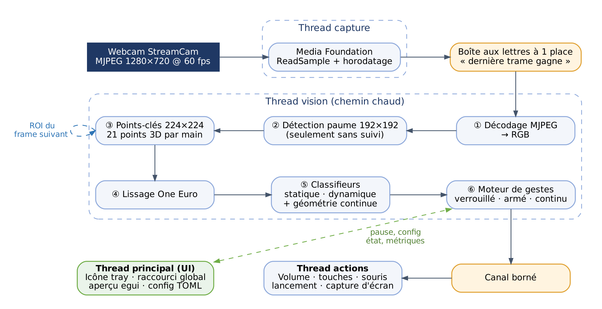
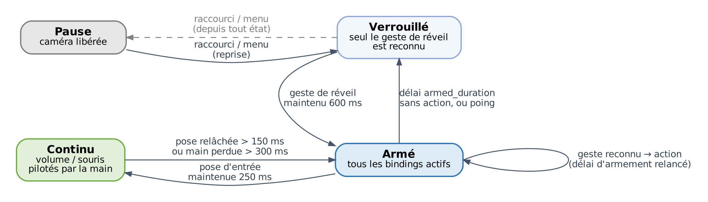

<!-- Converti depuis Cahier_des_charges_Mudra.docx par scripts/docx_to_md.py. Le nom de travail « Gestura » y est remplacé par « Mudra ». -->

CAHIER DES CHARGES TECHNIQUE

Mudra

Piloter son PC par des gestes de la main, via la webcam, en temps réel

Application Windows en Rust · entraînement des modèles en Python

| Élément | Valeur |
|---|---|
| Projet | Mudra |
| Version du document | 1.0 du 9 octobre 2026 |
| Destinataire | Claude Code, chargé de l'implémentation, sous la supervision de l'utilisateur |
| Plateforme cible | Windows 10/11 x64 · i7-10700K · RTX 3070 · Logitech StreamCam |
| Langages | Rust (application, 100 % à l'exécution) · Python (entraînement hors ligne uniquement) |
| Statut | Spécification validée, prête pour l'implémentation par phases (§12) |

L'essentiel en six points

Pas de réseau sur les images brutes. Un pipeline MediaPipe Hands (ONNX) extrait 21 points-clés 3D par main ; de petits réseaux entraînés sur tes propres données classent ces points.

Vision sur GPU via DirectML (repli CPU automatique) avec ort (ONNX Runtime) ; le benchmark B-01 confirme ou révise ce choix.

Capture MJPEG 1280×720 à 60 fps via Media Foundation, politique « dernière trame gagne » : la latence ne s'accumule jamais.

Suivi de la main d'une trame à l'autre : la détection de paume ne tourne que lorsqu'aucune main n'est suivie ; mode veille économe sans main.

Trois familles de gestes : poses statiques, gestes dynamiques, contrôles continus ; un geste de réveil protège des déclenchements involontaires.

Application discrète : icône de zone de notification, configuration TOML rechargée à chaud, fenêtre d'aperçu à la demande.

Sommaire

0. Mode d'emploi pour Claude Code

1. Contexte, objectifs et périmètre

2. Environnement cible

3. Architecture d'ensemble

4. Décisions techniques (D-01 à D-20)

5. Exigences fonctionnelles

6. Exigences non fonctionnelles

7. Spécifications détaillées des modules

8. Chaîne d'apprentissage (données, entraînement, export)

9. Organisation du dépôt et conventions

10. Tests, mesures et benchmarks

11. Sécurité et confidentialité

12. Plan de livraison par phases

13. Critères d'acceptation

14. Risques et points d'attention

Annexes : A. Points-clés · B. Gestes initiaux · C. Configuration · D. Dépendances · E. Glossaire

## 0. Mode d'emploi pour Claude Code

Ce document est la source de vérité du projet. Il fixe les choix techniques pour que tu puisses implémenter sans redemander ce qui est déjà tranché. Voici comment le lire et l'utiliser.

- Commence par le convertir en Markdown dans le dépôt (pandoc -t gfm cahier.docx -o docs/cahier-des-charges.md) pour pouvoir le relire et le citer facilement.
- Identifiants : EF-xx exigences fonctionnelles, ENF-xx non fonctionnelles, D-xx décisions techniques, B-xx benchmarks, CA-xx critères d'acceptation. Cite-les dans les messages de commit et les commentaires de code quand c'est pertinent.
- Priorités : Doit = obligatoire pour clore la phase ; Devrait = attendu, report possible avec justification écrite ; Pourrait = bonus si le temps le permet.
- Décisions figées : une décision D-xx ne se remet en cause que sur la base d'une mesure. Toute dérogation est consignée dans docs/adr/NNNN-titre.md (contexte, mesure, décision) et signalée à l'utilisateur.
- Versions : les versions de crates citées reflètent l'état d'octobre 2026. Vérifie la dernière version stable sur crates.io/docs.rs au moment d'ajouter une dépendance et adapte-toi à son API.
- Travail par phases (§12) : chaque phase se termine par des tests au vert, des mesures consignées dans docs/perf-report.md et une démonstration reproductible. Demande la validation de l'utilisateur avant d'entamer la phase suivante.
- Matériel : tu ne vois pas la webcam et ne peux pas faire de gestes. Pour tout ce qui exige l'utilisateur (enregistrement de gestes, démo, test réel), prépare des commandes prêtes à lancer et demande-lui de te rapporter la sortie de mudra bench ou mudra devices.
- Questions : ne redemande pas ce qui est couvert ici. Pose une question uniquement pour un choix absent du document et coûteux à défaire.

## 1. Contexte, objectifs et périmètre

### 1.1 Contexte

L'utilisateur, seul utilisateur du logiciel, veut déclencher des actions sur son PC Windows (ouvrir un programme, régler le volume, faire une capture d'écran, etc.) par des gestes de la main filmés par sa webcam. Il veut pouvoir définir ses propres gestes en entraînant de petits réseaux de neurones sur ses données, et exige un logiciel en Rust, temps réel, au coût en ressources minimal.

### 1.2 Objectifs

| ID | Objectif |
|---|---|
| O1 | Reconnaître en temps réel les poses statiques, les gestes dynamiques et les contrôles continus des mains. |
| O2 | Associer chaque geste à une action Windows configurable : programme, volume, capture d'écran, raccourcis, touches multimédia, souris. |
| O3 | Minimiser la latence et le coût en ressources (CPU, GPU, RAM), en particulier lorsqu'aucune main n'est visible. |
| O4 | Permettre d'ajouter un geste personnalisé de bout en bout (enregistrement → entraînement → configuration) en moins de 15 minutes. |
| O5 | Rendre les déclenchements involontaires quasi inexistants dans l'usage quotidien du PC. |

### 1.3 Périmètre

| Dans le périmètre | Hors périmètre |
|---|---|
| Windows 10/11 x64, une webcam<br>1 ou 2 mains simultanées<br>Application en zone de notification + configuration TOML<br>Outils d'enregistrement de données, d'entraînement et d'export<br>Fenêtre d'aperçu et de diagnostic | macOS, Linux<br>Plusieurs caméras simultanées<br>Suivi du corps ou du visage, langue des signes<br>Éditeur graphique complet des gestes et actions (l'édition passe par le TOML)<br>Service réseau, cloud, télémétrie ; installeur signé et distribution publique |

### 1.4 Principe retenu

Entraîner un réseau directement sur les images de la webcam demanderait des milliers d'images par geste et resterait sensible à l'éclairage et à l'arrière-plan. Le système utilise donc un pipeline à deux étages éprouvé : des modèles pré-entraînés (MediaPipe Hands) localisent la main et extraient 21 points-clés 3D ; les réseaux propres à l'utilisateur ne voient que ces points.

- Robuste : indifférent à l'arrière-plan, à la couleur de peau et, dans une large mesure, à la lumière.
- Économe en données : quelques centaines d'exemples par geste suffisent, enregistrés en quelques minutes.
- Minuscule : classifieurs de quelques dizaines de milliers de paramètres, inférence de l'ordre de 0,1 ms sur CPU.

## 2. Environnement cible

| Composant | Caractéristiques | Conséquences pour le projet |
|---|---|---|
| Système | Windows 10 22H2 ou Windows 11, x64 | API Win32/COM via le crate windows ; Media Foundation disponible. |
| CPU | Intel Core i7-10700K, 8 cœurs / 16 threads, 3,8 GHz | AVX2 disponible, pas d'AVX-512. Compilation avec target-cpu=native. |
| GPU | NVIDIA GeForce RTX 3070, 8 Go, DirectX 12 | Inférence de la vision via DirectML (ou CUDA/TensorRT en option). |
| Webcam | Logitech StreamCam, USB-C (USB 3.1 Gen 1), champ 78°, autofocus<br>Résolutions : 1920×1080, 1280×720, 960×540, 848×480, 640×360, 320×240 | 60 fps uniquement en MJPEG ; YUY2/NV12 plafonnés à 30 fps.<br>Le décodage MJPEG est donc dans le chemin chaud (voir D-03, D-04). |
| Toolchain Rust | Rust stable (édition 2024), cible x86_64-pc-windows-msvc | Visual Studio Build Tools (MSVC + Windows SDK) requis. |
| Python | Python 3.12+, géré par uv ; PyTorch (CUDA ou CPU) | Utilisé uniquement hors ligne, pour entraîner et exporter les modèles. |

Pourquoi MJPEG plutôt que NV12 ?

À 60 fps, une trame arrive toutes les 16,7 ms contre 33,3 ms à 30 fps : la latence d'acquisition est divisée par deux. Le prix est un décodage JPEG d'environ 1 à 3 ms par trame traitée, largement compensé. Le mode NV12 30 fps reste disponible en configuration pour qui privilégie la sobriété CPU.

## 3. Architecture d'ensemble

### 3.1 Pipeline de traitement



Figure 1 – Pipeline et répartition en threads

- Capture : Media Foundation livre des trames MJPEG 1280×720 horodatées.
- Décodage MJPEG → RGB, uniquement pour les trames réellement traitées.
- Détection de paume (modèle BlazePalm, entrée 192×192), seulement lorsqu'aucune main n'est suivie, ou périodiquement si moins de mains que le maximum sont suivies.
- Points-clés de la main (entrée 224×224) sur une région recadrée et redressée ; la région de la trame suivante est déduite des points-clés : c'est le suivi.
- Lissage temporel des 21 points par filtre One Euro.
- Classification : modèle statique à chaque trame, modèle dynamique sur fenêtre glissante, grandeurs géométriques pour les contrôles continus.
- Moteur de gestes : machine à états (verrouillé, armé, continu), seuils, maintien, hystérésis, délais de réarmement.
- Exécution des actions Windows sur un thread dédié, sans jamais bloquer la vision.

### 3.2 Modèle de threads

| Thread | Rôle | Priorité | Communication |
|---|---|---|---|
| capture | Lecture bloquante des trames (ReadSample), horodatage QPC, dépôt de la trame compressée dans une boîte aux lettres à une place. | Au-dessus de la normale ; MMCSS « Capture » si disponible | → vision (la plus récente écrase l'ancienne) |
| vision | Décodage, détection, points-clés, lissage, classification, moteur de gestes. | Au-dessus de la normale ; MMCSS « Capture » si disponible | → actions (canal borné) ; → UI (dernière valeur) |
| actions | Appels COM/Win32 : volume, SendInput, lancement, capture d'écran. COM initialisé en MTA. | Normale | ← vision ; → worker |
| worker | Tâches longues : encodage PNG, écriture du dataset. | En dessous de la normale | ← actions, vision |
| principal (UI) | Boucle d'événements winit unique : icône de notification, raccourci global, fenêtre d'aperçu, rechargement de la configuration. | Normale | ↔ tous, par canaux |

Règles du chemin chaud

Aucune file d'attente de trames : une file transforme chaque ralentissement en latence durable. Politique « dernière trame gagne », avec un compteur de trames abandonnées exposé.

Aucun verrou bloquant entre capture et vision ; échanges par crossbeam-channel ou slot atomique.

Aucune allocation dans la boucle après la phase de préchauffage (ENF-06) : buffers réutilisés, pool de trames.

## 4. Décisions techniques

Ces décisions sont figées. Une révision exige une mesure et un ADR (voir §0).

| ID | Sujet | Décision | Justification · alternatives écartées |
|---|---|---|---|
| D-01 | Langages | Rust stable pour toute l'application. Python uniquement hors ligne pour l'entraînement (choix de l'utilisateur). | Écosystème d'entraînement mature en Python ; aucun Python n'est requis pour utiliser l'application. |
| D-02 | Capture vidéo | Media Foundation directement via le crate windows : IMFSourceReader synchrone sur un thread dédié, attributs MF_LOW_LATENCY et MF_READWRITE_DISABLE_CONVERTERS, derrière un trait FrameSource. | Contrôle total du format natif, de la latence et des réglages caméra. nokhwa écarté : abstraction multiplateforme inutile ici et moins de contrôle. |
| D-03 | Format caméra | Défaut : MJPEG 1280×720 à 60 fps. Économique : MJPEG 640×360 à 60 fps. Option : NV12 640×360 à 30 fps (sans décodage). | Latence d'acquisition divisée par deux à 60 fps ; 720p garde assez de pixels pour une main à 1,5 m. |
| D-04 | Décodage MJPEG | zune-jpeg (Rust pur, AVX2) dans un buffer réutilisé ; libjpeg-turbo-rs évalué en alternative (B-02), le plus rapide est retenu. Gérer les trames sans table de Huffman (DHT absente, fréquent en MJPEG de webcam). | Pas de dépendance C à compiler ; budget de 3 ms p95 en 720p. |
| D-05 | Modèles de vision | MediaPipe Hands en ONNX issus d'opencv_zoo : palm_detection_mediapipe_2023feb.onnx (192×192) et handpose_estimation_mediapipe_2023feb.onnx (224×224), en float32 (pas les variantes int8). Licence Apache 2.0 : conserver LICENSE et NOTICE. | Modèles éprouvés et légers. Le modèle de points-clés fournit 21 points image, 21 points « monde » en mètres, la latéralité et un score de présence. La variante int8 est signalée comme dégradant fortement la précision. |
| D-06 | Moteur d'inférence | ort 2.0 (ONNX Runtime ; 2.0.0-rc.13 à la rédaction). | Binding Rust le plus mature, nombreux fournisseurs d'exécution. |
| D-07 | Fournisseur d'exécution de la vision | Défaut : DirectML (RTX 3070), repli automatique sur CPU. CUDA et TensorRT en features Cargo optionnelles et mutuellement exclusives (ep-cuda, ep-tensorrt). Le défaut est confirmé ou révisé uniquement par le benchmark B-01. | DirectML est un composant de Windows, sans installation CUDA, avec binaires précompilés par ort. CUDA/TensorRT ajoutent des centaines de Mo de DLL pour des modèles de quelques Mo. DirectML est en « sustained engineering » chez Microsoft (supporté, sans nouvelles fonctions). Sur des modèles aussi petits, le CPU peut rivaliser : le benchmark tranche. |
| D-08 | Classifieurs de gestes | Petits réseaux PyTorch exportés en ONNX (opset ≥ 17), exécutés par ort sur l'EP CPU, en sessions séparées avec 1 thread intra-op. | Inférence de l'ordre de 0,1 ms ; une synchronisation GPU coûterait plus que le calcul lui-même. |
| D-09 | Extraction des features | Intégrée dans le graphe ONNX : un module PyTorch FeatureExtractor est exporté avec chaque modèle. Rust ne fournit que les points-clés lissés et la latéralité. | Source de vérité unique : aucun écart possible entre entraînement et inférence. Contrainte : n'utiliser que des opérations exportables (pas d'atan2 ; préférer acos borné ou les représentations cos/sin). |
| D-10 | Métadonnées des modèles | Classes, version du format d'entrée, taille de fenêtre et fréquence d'échantillonnage stockées dans les metadata_props de l'ONNX. L'application les lit au chargement et valide la configuration. | Aucune liste de labels dupliquée à la main ; un geste inconnu de la configuration produit une erreur explicite. |
| D-11 | Lissage | Filtre One Euro par coordonnée, paramètres configurables, profil distinct pour la souris. | Standard du suivi interactif : stable au repos, réactif en mouvement. |
| D-12 | Moteur de gestes | Machine à états déterministe, sans entrées/sorties, horloge injectée. | Testable par rejeu de sessions enregistrées, sans caméra. |
| D-13 | Activation | Geste de réveil + raccourci clavier global de pause (choix de l'utilisateur). | Premier rempart contre les déclenchements involontaires. |
| D-14 | Interface | Icône de notification (tray-icon, menus muda) et fenêtre d'aperçu egui ouverte à la demande. Une seule boucle d'événements winit, sur le thread principal. | Choix de l'utilisateur. Fenêtre fermée = aucun coût de rendu. Une seule EventLoop winit est permise par processus. |
| D-15 | Configuration | TOML (serde + toml) dans %APPDATA%\Mudra\config.toml, surveillé par notify. En cas d'erreur, la dernière configuration valide est conservée et l'utilisateur est notifié. | Lisible, versionnable, éditable dans n'importe quel éditeur. |
| D-16 | Actions Windows | Crate windows en direct : Core Audio (IAudioEndpointVolume), SendInput, ShellExecuteW/CreateProcessW ; xcap pour la capture d'écran, encodage PNG sur le thread worker. | Dépendances minimales, contrôle fin, pas de surcouche. |
| D-17 | Concurrence | Threads natifs + crossbeam-channel. Pas de runtime async (tokio) dans le chemin chaud. | Charge temps réel liée au calcul : l'async n'apporte rien et ajoute de la gigue. |
| D-18 | Observabilité | tracing avec journaux fichiers rotatifs dans %LOCALAPPDATA%\Mudra\logs, histogrammes de latence par étage (hdrhistogram), feature optionnelle profiling (tracing-tracy). | Mesurer avant d'optimiser ; pas de journalisation par trame au niveau info. |
| D-19 | Gestion d'erreurs | thiserror dans les bibliothèques, anyhow dans le binaire. Aucun unwrap() hors tests et invariants documentés. | Erreurs explicites et remontées à l'utilisateur. |
| D-20 | Compilation release | lto = "fat", codegen-units = 1, opt-level = 3, debug = "line-tables-only" ; -C target-cpu=native via .cargo/config.toml. | Binaire destiné à cette machine uniquement : on exploite AVX2 sans compromis. |

## 5. Exigences fonctionnelles

### 5.1 Capture vidéo

| ID | Exigence | Priorité |
|---|---|---|
| EF-01 | Lister les caméras et leurs formats natifs (mudra devices) : nom, sous-type, résolution, fréquence. | Doit |
| EF-02 | Ouvrir la caméra configurée (par nom ou index) dans le format demandé ; à défaut, se replier sur le format natif le plus proche et le signaler. | Doit |
| EF-03 | Mesurer la fréquence réelle et alerter si elle s'écarte de plus de 10 % de la cible (cas typique : chute à 30 fps en faible lumière). | Doit |
| EF-04 | Exposer dans la configuration les réglages utiles : exposition auto ou manuelle, gain, mise au point, et désactivation de la priorité d'exposition automatique (contrôle UVC Auto-Exposure Priority, via IKsControl / KSPROPERTY_CAMERACONTROL_AUTO_EXPOSURE_PRIORITY), cause de la chute de fréquence. | Devrait |
| EF-05 | Reprendre automatiquement si la caméra est débranchée ou occupée : réessais avec backoff (jusqu'à 30 s d'intervalle) et notification. | Doit |
| EF-06 | Libérer la caméra en pause (le voyant s'éteint). | Doit |
| EF-07 | Miroir horizontal configurable (vue « selfie »), appliqué gratuitement dans la transformation affine du recadrage, jamais par copie d'image entière. | Doit |

### 5.2 Détection et suivi des mains

| ID | Exigence | Priorité |
|---|---|---|
| EF-10 | Détecter jusqu'à max_hands mains (défaut 1, maximum 2). | Doit |
| EF-11 | Fournir, par main et par trame : 21 points image (x, y normalisés, z relatif), 21 points monde (mètres), latéralité et son score, score de présence, boîte englobante, identifiant de piste stable. | Doit |
| EF-12 | Suivi : la région d'intérêt de la trame N+1 est calculée depuis les points-clés de la trame N. La détection de paume ne s'exécute que si aucune main n'est suivie, si le score de présence passe sous le seuil, ou, si moins de max_hands mains sont suivies, au plus toutes les K trames (défaut K = 10). | Doit |
| EF-13 | Mode veille : sans main suivie, ne traiter qu'une trame sur N pour la détection de paume (défaut 10 Hz). Les trames ignorées ne sont pas décodées. Retour au plein régime dès qu'une main est détectée. | Doit |
| EF-14 | Latéralité correcte compte tenu du miroir (le modèle suppose une image de type selfie). Vérifiée par un test doré avec une main droite connue. | Doit |
| EF-15 | Écarter les détections improbables : main trop petite, rapport d'aspect aberrant, saut de position impossible entre deux trames. | Devrait |

### 5.3 Reconnaissance des gestes

| ID | Exigence | Priorité |
|---|---|---|
| EF-20 | Poses statiques : classification à chaque trame et pour chaque main ; sortie = distribution de probabilités incluant une classe none. | Doit |
| EF-21 | Gestes dynamiques : classification sur une fenêtre glissante de T trames (défaut T = 32, soit environ 0,53 s), ré-échantillonnée à 60 Hz d'après les horodatages, évaluée toutes les 2 trames, avec classe none. | Doit |
| EF-22 | Contrôles continus : grandeurs géométriques calculées en Rust sur les points lissés (écart pouce-index normalisé par la taille de paume, déplacement depuis l'entrée en mode, position de l'index, angle du poignet). | Doit |
| EF-23 | Gestes propres à une main ou ambidextres (champ hand = left \| right \| any). | Doit |
| EF-24 | Gestes à deux mains simples (par exemple deux paumes ouvertes) par combinaison de poses statiques dans le moteur, sans modèle dédié. | Pourrait |
| EF-25 | Jeu de gestes initial (Annexe B) livré avec des modèles entraînés sur les données de l'utilisateur à la phase 3. | Doit |

### 5.4 Moteur de gestes et activation



Figure 2 – États du moteur de gestes

| ID | Exigence | Priorité |
|---|---|---|
| EF-30 | États : Pause (caméra libérée) ; Verrouillé (seul le geste de réveil est reconnu) ; Armé (tous les bindings actifs, retour à Verrouillé après armed_duration_ms sans action, défaut 4 s, délai relancé à chaque action, ou sur le geste de verrouillage) ; Continu (un contrôle continu est en cours ; sortie quand la pose d'entrée est relâchée plus de 150 ms ou la main perdue plus de 300 ms). | Doit |
| EF-31 | Pose statique confirmée si p ≥ static_enter (défaut 0,85) pendant hold_ms (défaut 300 ms), main quasi immobile ; relâchée si p < static_exit (défaut 0,60) pendant au moins 100 ms (hystérésis). Déclenchement sur front montant ; répétition optionnelle repeat_ms tant que la pose est maintenue. | Doit |
| EF-32 | Geste dynamique déclenché si p ≥ dynamic_threshold (défaut 0,80) sur 2 évaluations consécutives, suivi d'une période réfractaire (défaut 600 ms) et du vidage de la fenêtre. | Doit |
| EF-33 | Arbitrage : un geste dynamique déclenché suspend la confirmation des poses statiques pendant 300 ms ; une main en mouvement rapide (au-dessus d'un seuil de vitesse) ne confirme aucune pose. | Doit |
| EF-34 | Délai de réarmement (cooldown) par binding, défaut 800 ms. | Doit |
| EF-35 | Raccourci clavier global (défaut Ctrl+Alt+G) pour Pause/Reprise, opérationnel en toutes circonstances. | Doit |
| EF-36 | Retour d'état via l'icône de notification (couleur par état) et retour sonore optionnel (sons système) à l'armement et à chaque déclenchement. | Doit |
| EF-37 | Petit overlay discret (fenêtre transparente, au premier plan, traversable par la souris) affichant l'état et le dernier geste reconnu. | Pourrait |

### 5.5 Actions

| Type | Description | Implémentation |
|---|---|---|
| launch | Lancer un programme, document ou URL avec arguments et dossier de travail ; option focus_if_running (Pourrait). | ShellExecuteW (documents, URL, .lnk) ou CreateProcessW |
| volume | step (± delta), set (0 à 1), mute_toggle. Mode api (précis, silencieux) ou keys (affiche l'OSD Windows). | IAudioEndpointVolume sur le périphérique de rendu par défaut, ou SendInput VK_VOLUME_* |
| media | Lecture/pause, suivant, précédent, stop. | SendInput VK_MEDIA_* |
| keys | Combinaison arbitraire : « Ctrl+Shift+Esc », « Win+D », « Alt+Tab »… | SendInput avec scancodes |
| screenshot | Écran complet, moniteur actif ou fenêtre active ; PNG horodaté dans un dossier ; copie optionnelle dans le presse-papiers. | xcap, encodage PNG sur le worker, presse-papiers Win32 (CF_DIB) |
| snip | Ouvrir l'outil Capture d'écran de Windows. | SendInput Win+Shift+S |
| mouse | Déplacement absolu (contrôle continu), clic gauche/droit, défilement. | SendInput MOUSEEVENTF_ABSOLUTE \| VIRTUALDESK |
| command | Commande shell ou PowerShell. Désactivée par défaut (allow_commands = true requis). | CreateProcessW sans fenêtre |
| sequence | Liste d'actions avec délais. | Composition |
| internal | toggle_pause, lock, notify. | Moteur / UI |

| ID | Exigence | Priorité |
|---|---|---|
| EF-40 | Toutes les actions du tableau ci-dessus, sauf mention « Pourrait ». | Doit |
| EF-41 | Les actions s'exécutent hors du thread vision : une action lente ne retarde jamais la vision. Canal borné ; s'il est plein, l'action est abandonnée et journalisée. | Doit |
| EF-42 | Journaliser chaque déclenchement : geste, confiance, action, latence mesurée. | Doit |
| EF-43 | Documenter la limite UIPI : Windows bloque l'injection d'entrées vers une fenêtre exécutée en administrateur si Mudra ne l'est pas. | Doit |

### 5.6 Contrôles continus

| ID | Exigence | Priorité |
|---|---|---|
| EF-50 | Volume continu : entrée par la pose pinch maintenue 250 ms en état Armé ; le volume suit le déplacement vertical de la main depuis l'entrée (gain et zone morte configurables, mode api) ; sortie au relâchement. | Doit |
| EF-51 | Souris : la pose pointing fait suivre le curseur à l'index (zone active = rectangle central configurable de l'image, projeté sur l'écran principal ou le bureau virtuel), lissage One Euro dédié, clic par pincement avec hystérésis (fermé sous 0,25, ouvert au-dessus de 0,35 fois la taille de paume). | Devrait |
| EF-52 | Défilement par déplacement vertical à deux doigts ; rotation du poignet associée à une grandeur (molette, luminosité…). | Pourrait |

### 5.7 Enregistrement de données et entraînement

| ID | Exigence | Priorité |
|---|---|---|
| EF-60 | mudra record enregistre des séquences de points-clés (pas d'images par défaut) pour un label. Mode statique : capture continue pendant N secondes en variant légèrement position et orientation. Mode dynamique : R répétitions guidées (compte à rebours + bip), chaque clip étant une fenêtre de 1,0 s centrée sur le geste. | Doit |
| EF-61 | Enregistrer une classe none réaliste : mains au repos, frappe au clavier, souris, se gratter, boire, visioconférence… sur plusieurs minutes. Indispensable contre les faux positifs. | Doit |
| EF-62 | Format : un fichier JSON Lines par session (dataset/<static\|dynamic>/<label>/<session>.jsonl). Première ligne = métadonnées (version du format, caméra, résolution, fps, miroir, main) ; puis une ligne par trame : horodatage (µs), piste, latéralité et score, présence, 21×3 points image, 21×3 points monde. Option --save-frames (debug) pour stocker les recadrages 224×224 en JPEG. | Doit |
| EF-63 | Projet Python training/ géré par uv : uv run mudra-train all entraîne, évalue et écrit les .onnx dans models/. | Doit |
| EF-64 | mudra replay <session> rejoue une session dans le moteur de gestes, sans caméra, et affiche les événements produits (tests, réglage des seuils). | Doit |
| EF-65 | Rechargement à chaud des modèles de classification lorsqu'un fichier .onnx est remplacé. | Devrait |
| EF-66 | Entrée de menu « Enregistrer un geste… » ouvrant l'aperçu avec un assistant minimal (label, type, nombre de répétitions). | Devrait |

### 5.8 Interface

| ID | Exigence | Priorité |
|---|---|---|
| EF-70 | Icône de notification avec menu : état courant ; Pause/Reprendre ; Ouvrir l'aperçu ; Recharger la configuration ; Ouvrir le dossier de configuration ; Ouvrir les journaux ; Quitter. | Doit |
| EF-71 | Fenêtre d'aperçu (egui) : image caméra (affichage plafonné à 30 fps), points-clés et région d'intérêt dessinés, top-3 des probabilités statiques et dynamiques, état du moteur, fps de capture et de traitement, latences p50/p95 par étage, trames abandonnées. | Doit |
| EF-72 | Fenêtre fermée : aucun coût de rendu, aucune copie d'image vers l'UI. | Doit |
| EF-73 | Interface en ligne de commande (clap) : run (défaut), devices, record, replay, bench, check-config. | Doit |
| EF-74 | Instance unique (mutex nommé) ; lancement à l'ouverture de session optionnel (clé HKCU\Software\Microsoft\Windows\CurrentVersion\Run). | Devrait |
| EF-75 | Binaire release sans console (windows_subsystem = "windows") ; les sous-commandes CLI s'attachent à la console parente. | Doit |

## 6. Exigences non fonctionnelles

### 6.1 Performances

Mesures sur la machine cible, une main suivie, MJPEG 1280×720 à 60 fps, build release.

| ID | Exigence | Cible |
|---|---|---|
| ENF-01 | Débit : traiter 60 fps sans accumulation. | Trames abandonnées < 1 % en régime établi |
| ENF-02 | Latence de traitement par trame, de l'arrivée de la trame à la décision du moteur. | p95 ≤ 8 ms · p99 ≤ 12 ms |
| ENF-03 | Latence perçue. | Pose : hold_ms + 30 ms max<br>Geste dynamique : ≤ 100 ms après la fin du mouvement<br>Contrôle continu : ≤ 50 ms (hors lissage) |
| ENF-04 | Ressources (cibles à confirmer par B-01 ; si l'une est inatteignable, documenter la mesure et proposer un compromis). | CPU process ≤ 8 % de la machine avec main, ≤ 2 % sans main<br>RAM ≤ 250 Mo · VRAM ≤ 400 Mo |
| ENF-05 | Démarrage jusqu'à la première trame traitée (hors première compilation d'un moteur TensorRT, mise en cache sur disque). | ≤ 2 s |
| ENF-06 | Zéro allocation dans la boucle chaude après préchauffage, vérifié par un allocateur compteur (feature alloc-audit). | 0 allocation/trame |

#### Budget indicatif par étage (p95)

| Étage | Budget | Remarque |
|---|---|---|
| Décodage MJPEG 720p | ≤ 3,0 ms | Seulement pour les trames traitées |
| Recadrage affine + normalisation | ≤ 0,5 ms | Écrit directement dans le tenseur d'entrée |
| Points-clés (224×224) | ≤ 3,0 ms | Par main suivie |
| Détection de paume (192×192) | ≤ 4,0 ms | Exécutée rarement grâce au suivi |
| Classifieurs statique et dynamique | ≤ 0,5 ms | EP CPU, 1 thread |
| Moteur + envoi de l'action | ≤ 0,2 ms | Sans E/S |

### 6.2 Qualité de reconnaissance et fiabilité

| ID | Exigence | Cible |
|---|---|---|
| ENF-10 | Poses statiques, sur des sessions de test jamais vues à l'entraînement. | Macro-F1 ≥ 97 % |
| ENF-11 | Gestes dynamiques, sur des sessions jamais vues. | Rappel ≥ 95 % · précision ≥ 97 % |
| ENF-12 | Déclenchements involontaires en usage normal du PC (rejeu de longues sessions none + test réel). | ≤ 1 action/heure en Armé · ≤ 1 réveil/heure en Verrouillé |
| ENF-13 | Conditions d'usage : éclairage de bureau courant, main entre 0,3 et 1,5 m de la caméra. | Exigences ENF-10 à 12 tenues |
| ENF-14 | Stabilité en fonctionnement continu. | 8 h sans plantage, dérive RAM < 10 Mo |

### 6.3 Maintenabilité

| ID | Exigence | Cible |
|---|---|---|
| ENF-30 | cargo fmt et cargo clippy -- -D warnings propres ; rustdoc des API publiques. | CI au vert |
| ENF-31 | Couverture de tests du moteur de gestes, de la géométrie et de la configuration (cargo llvm-cov). | ≥ 80 % |
| ENF-32 | Licences des dépendances compatibles (MIT, Apache-2.0, BSD, Zlib…), vérifiées par cargo deny. | 0 violation |

## 7. Spécifications détaillées des modules

### 7.1 Capture (mudra-capture)

- Trait FrameSource exposant next_frame() ; RawFrame porte un buffer issu d'un pool, le format (Mjpeg, Nv12, Yuy2), la taille, un horodatage QPC et un numéro de séquence.
- Initialisation : MFStartup, énumération par MFEnumDeviceSources (source vidéo), IMFSourceReader avec MF_LOW_LATENCY = TRUE et MF_READWRITE_DISABLE_CONVERTERS = TRUE. Sélection du type natif exact (MFVideoFormat_MJPG, 1280×720, 60/1) via GetNativeMediaType.
- ReadSample synchrone sur le thread capture ; horodatage QueryPerformanceCounter à la réception (le timestamp MF est conservé pour diagnostic).
- Pool de 3 buffers (triple buffering) : la boîte aux lettres échange des indices, jamais des copies.
- Réglages caméra par IAMCameraControl / IAMVideoProcAmp obtenus sur la IMFMediaSource, et IKsControl pour la priorité d'exposition (EF-04).

### 7.2 Décodage et prétraitement (mudra-vision)

- MJPEG décodé en RGB8 dans un buffer persistant. En NV12, pas de conversion globale : l'échantillonneur lit directement les plans Y et UV.
- Échantillonneur affine unique : (image source, matrice 2×3 combinant miroir, rotation, échelle et translation) → tenseur f32 NHWC normalisé dans [0, 1], interpolation bilinéaire, écrit directement dans le buffer du tenseur ort. Le même code sert au letterbox 192×192 de la paume et au recadrage 224×224 des points-clés.
- Implémentation par lignes avec coordonnées incrémentales, conçue pour l'auto-vectorisation ; micro-benchmark criterion (B-04).

### 7.3 Détection de paume

- Entrée [1,192,192,3] float32 RGB/255, letterbox centré (bordures noires).
- Sorties : régressions [1,2016,18] (boîte cx, cy, w, h + 7 points × 2) et scores [1,2016,1] (logits, puis sigmoïde). Identifier les sorties par nom et par forme, jamais par leur index.
- 2016 ancres SSD (24×24×2 au pas 8 + 12×12×6 au pas 16) ; les vérifier contre l'implémentation de référence mp_palmdet.py d'opencv_zoo.
- Seuil de score 0,5 ; NMS avec IoU 0,3. Préférer la NMS pondérée de MediaPipe, plus stable d'une trame à l'autre.

### 7.4 Points-clés et suivi

- Région depuis la paume : rotation alignant le poignet (point de paume 0) sur la base du majeur (point de paume 2) vers le haut, boîte décalée et agrandie. Constantes de référence : décalage y de −0,4 et agrandissement ×3 (opencv_zoo), ou −0,5 et ×2,6 (graphe MediaPipe). Choisir par test doré.
- Région depuis les points-clés (suivi) : rotation calculée de 0 (poignet) vers 9 (MCP du majeur), boîte englobante des points décalée de −0,1 et agrandie ×1,65, rendue carrée.
- Entrée [1,224,224,3] float32 RGB/255. Sorties : points [1,63] (pixels de l'entrée 224 + z), présence [1,1], latéralité [1,1], points monde [1,63].
- Main perdue si présence < 0,6 (configurable) : la piste est fermée et la détection de paume reprend.
- Reprojection des points dans l'image source par la matrice affine inverse.
- Multi-mains : association région ↔ piste par IoU ; fusion des pistes en double (IoU > 0,5).

### 7.5 Lissage

- One Euro sur chaque coordonnée des 21 points, exprimées en unités de taille de paume. Valeurs de départ : min_cutoff = 1,0 Hz, beta = 0,05, d_cutoff = 1,0, à calibrer en phase 4 avec l'aperçu.
- Profil distinct pour la souris (plus de lissage au repos, plus de réactivité en mouvement).
- Réinitialisation du filtre à la perte de piste.

### 7.6 Classifieurs

Les deux modèles sont définis et entraînés en Python, puis exécutés en Rust. Leur FeatureExtractor fait partie du graphe exporté (D-09).

|  | Modèle statique (pose) | Modèle dynamique (mouvement) |
|---|---|---|
| Entrées | world [1,21,3] : points monde<br>handedness [1,1] : 0 = gauche, 1 = droite | image [1,T,21,3] : points image (miroir déjà appliqué)<br>world [1,T,21,3]<br>handedness [1,1] |
| Features (dans le graphe) | Miroir de la forme pour la main gauche (un modèle pour les deux mains)<br>Translation au poignet, normalisation par la distance poignet → MCP du majeur<br>15 angles de flexion (acos borné)<br>Distances bout du pouce ↔ autres bouts, et entre bouts voisins<br>Orientation de la paume (normale, axe poignet → majeur) | Features statiques de chaque trame<br>Trajectoire du centre de la main dans l'image, relative à la dernière trame, normalisée par la taille de paume moyenne<br>Vitesses (différences finies)<br>Le miroir gauche → droite s'applique à la forme, jamais à la trajectoire |
| Réseau | MLP ≈ 91 → 128 → 64 → K, ReLU, LayerNorm, dropout 0,2 à l'entraînement ; environ 20 k paramètres | 3 convolutions temporelles 1D (64 canaux, noyau 5, dilatations 1/2/4), pooling global, couche dense → K ; environ 60 k paramètres |
| Sortie | probs [1,K] (softmax inclus), classe none obligatoire | probs [1,K], classe none obligatoire |
| Côté Rust | Appel à chaque trame et pour chaque main | Tampon circulaire par piste des T dernières trames, ré-échantillonnées à 60 Hz par interpolation linéaire des horodatages |

Calibration des probabilités par temperature scaling sur le jeu de validation (Devrait).

### 7.7 Moteur de gestes (mudra-gestures)

- Entrées : HandFrame (piste, points lissés, probabilités statiques et dynamiques, vitesse) et l'instant courant fourni par une horloge injectée.
- Sorties : liste d'EngineEvent : StateChanged, GestureFired { binding, confidence }, ContinuousUpdate { control, value }.
- Paramètres par binding, avec valeurs par défaut globales (section [defaults] de la configuration).
- Transitions conformes à la figure 2 et à EF-30 à EF-34. Le geste de verrouillage (fist par défaut) ramène immédiatement à Verrouillé.
- Tests de propriétés (proptest) : aucune action en Verrouillé, cooldown toujours respecté, aucune transition sans événement déclencheur.

### 7.8 Actions (mudra-actions)

- Exécuteur sur son thread ; CoInitializeEx en MTA une fois ; IAudioEndpointVolume mis en cache et rafraîchi lors d'un changement de périphérique par défaut (IMMNotificationClient) ou d'une erreur.
- SendInput avec scancodes (KEYEVENTF_SCANCODE, KEYEVENTF_EXTENDEDKEY si nécessaire) ; parseur de combinaisons testé (« Ctrl+Alt+T », « Win+Shift+S », touches multimédia).
- Capture d'écran sur le thread actions, encodage PNG rapide sur le worker ; chemin par défaut %USERPROFILE%\Pictures\Mudra\AAAA-MM-JJ_HH-MM-SS.png.
- Lancement : expansion de ~ et des variables d'environnement ; les échecs remontent en notification.

### 7.9 Configuration (mudra-config)

- Exemple complet en Annexe C ; config/default.toml est copié au premier lancement.
- Validation au chargement : gestes présents dans les métadonnées des modèles, raccourcis analysables, chemins existants, valeurs dans leurs bornes. mudra check-config exécute la même validation.
- Rechargement à chaud en moins d'une seconde ; une configuration invalide est refusée avec un message précis (fichier, ligne, champ) et la précédente reste active.

### 7.10 Interface (mudra-app)

- Icônes de notification générées (32×32 RGBA, embarquées) : gris = Pause, contour = Verrouillé, bleu = Armé, vert = Continu, rouge = erreur.
- Fenêtre d'aperçu : intégration egui dans la boucle winit du thread principal (egui-winit + egui-wgpu, ou eframe si l'ouverture/fermeture répétée fonctionne). Fenêtre créée et détruite à la demande. Point validé dès la phase 0 (spike).
- Les images transmises à l'aperçu passent par un slot « dernière valeur », uniquement quand la fenêtre est ouverte.

## 8. Chaîne d'apprentissage

### 8.1 Déroulé pour l'utilisateur

- mudra record --label thumbs_up --static --duration 20s (répéter sur 3 sessions, à des moments différents).
- mudra record --label swipe_left --dynamic --reps 15 pour un geste dynamique.
- mudra record --label none --static --duration 300s en utilisant normalement le PC.
- uv run mudra-train all : entraînement, évaluation, export ONNX dans models/ et rapport dans training/reports/.
- L'application recharge les modèles ; mudra replay vérifie le comportement sur des sessions de test.
- Ajouter le binding dans config.toml.

### 8.2 Projet Python

```
training/
├─ pyproject.toml          # uv ; torch, onnx, onnxruntime, scikit-learn…
├─ src/mudra_train/
│  ├─ data.py              # lecture JSONL, découpage par session
│  ├─ features.py          # FeatureExtractor (nn.Module exporté dans l'ONNX)
│  ├─ augment.py           # augmentations sur points bruts
│  ├─ models.py            # StaticMLP, DynamicTCN
│  ├─ train_static.py
│  ├─ train_dynamic.py
│  ├─ evaluate.py          # matrices de confusion, F1, faux positifs/heure
│  └─ export.py            # ONNX + metadata_props + vecteurs dorés
├─ tests/
└─ reports/
```

### 8.3 Données

| Type | Quantité recommandée |
|---|---|
| Pose statique | ≥ 3 sessions × 20 s par geste (environ 3 600 trames), en variant distance, angle et main |
| Geste dynamique | ≥ 40 répétitions par geste, réparties sur ≥ 3 sessions |
| Classe none | ≥ 15 min d'activité variée (clavier, souris, gestes parasites, visioconférence) |

### 8.4 Augmentations (sur points bruts, avant le FeatureExtractor)

- Rotation dans le plan ±15°, rotation 3D légère ±10°, échelle 0,85–1,15, bruit gaussien (σ = 1 % de la taille de paume).
- Miroir avec inversion de latéralité et inversion des labels directionnels (swipe_left ↔ swipe_right, rotate_cw ↔ rotate_ccw).
- Dynamique : déformation temporelle (vitesse 0,7–1,3×), décalage de fenêtre ±4 trames, trames manquantes interpolées.

### 8.5 Entraînement, évaluation, export

- Découpage par session, jamais par trame (sinon fuite de données et scores illusoires).
- AdamW, lr 1e-3, schedule cosinus, early stopping sur le F1 de validation, pondération des classes. Durée attendue : moins de 2 minutes (GPU ou CPU).
- Rapport : matrice de confusion, F1 par classe, faux positifs par heure sur les longues sessions none.
- Export : torch.onnx.export, opset ≥ 17, batch fixe à 1, noms d'entrées/sorties stables (world, image, handedness → probs), softmax inclus. Vérifier l'exporteur par défaut de la version de PyTorch installée.
- metadata_props : labels (JSON), feature_version, window_T, sample_rate_hz, created_at, dataset_hash.
- Validation : onnx.checker, comparaison onnxruntime vs PyTorch (écart max < 1e-5), génération de vecteurs dorés (tests/golden/*.json) consommés par un test Rust.

## 9. Organisation du dépôt et conventions

```
mudra/
├─ Cargo.toml                  # workspace + profils release (D-20)
├─ .cargo/config.toml          # target-cpu=native
├─ crates/
│  ├─ mudra-app/             # binaire : CLI, tray, aperçu, orchestration
│  ├─ mudra-capture/         # Media Foundation, FrameSource, réglages caméra
│  ├─ mudra-vision/          # décodage, recadrage affine, paume, points-clés, suivi
│  ├─ mudra-gestures/        # One Euro, fenêtres, classifieurs, moteur, continus
│  ├─ mudra-actions/         # volume, SendInput, lancement, capture d'écran
│  ├─ mudra-config/          # schéma TOML, validation, rechargement à chaud
│  └─ mudra-dataset/         # format JSONL, writer/reader, replay
├─ models/                     # .onnx, SHA256SUMS, LICENSE/NOTICE des modèles
├─ training/                   # projet Python (uv)
├─ config/default.toml
├─ scripts/fetch-models.ps1    # téléchargement + vérification SHA-256
├─ tests/fixtures/             # images de mains, sessions de rejeu, vecteurs dorés
└─ docs/                       # cahier-des-charges.md, adr/, perf-report.md
```

- Commits conventionnels (feat:, fix:, perf:…) référençant les identifiants du cahier.
- README : installation (Rust, VS Build Tools, uv), téléchargement des modèles, premier lancement, ajout d'un geste en moins de 15 minutes.
- Les DLL ONNX Runtime nécessaires sont copiées à côté de l'exécutable par le build (aucune installation système).

## 10. Tests, mesures et benchmarks

### 10.1 Tests automatisés

| Niveau | Contenu |
|---|---|
| Unitaires | Géométrie (affine, régions, rotations), ancres et décodage paume, NMS, One Euro, ré-échantillonnage temporel, parseur de raccourcis, validation de configuration. |
| Propriétés | Moteur de gestes avec proptest (invariants de §7.7). |
| Dorés | Images de mains (tests/fixtures, issues de mudra record --save-frames) : sorties paume et points-clés comparées à l'implémentation Python de référence d'opencv_zoo (tolérance 1 px / 1e-3). Vecteurs dorés des classifieurs. |
| Rejeu | Sessions enregistrées → événements attendus (*.expected.json) avec horloge simulée. |
| Matériel | Marqués #[ignore], lancés explicitement : ouverture caméra, fps réel, EP disponibles. |

### 10.2 Benchmarks

| ID | Objet | Protocole et usage |
|---|---|---|
| B-01 | Fournisseurs d'exécution | Pour chaque EP disponible (CPU, DirectML, CUDA, TensorRT) : latences p50/p95/p99 paume et points-clés sur 1 000 inférences après 100 de préchauffage, CPU %, RAM, VRAM, temps de démarrage. Fixe le défaut de D-07 : plus faible p95 respectant ENF-04 ; à ±0,5 ms près, le moins gourmand en CPU et RAM. |
| B-02 | Décodage MJPEG | zune-jpeg vs libjpeg-turbo-rs en 640×360, 1280×720, 1920×1080, sur de vraies trames de la StreamCam. |
| B-03 | Bout en bout | mudra bench --duration 120s en direct : histogrammes par étage, fps, trames abandonnées, CPU et RAM. Exécuté à la fin de chaque phase, résultats dans docs/perf-report.md. |
| B-04 | Micro-benchmarks | criterion : échantillonneur affine, extraction et classification, moteur. |

### 10.3 Intégration continue

GitHub Actions sur windows-latest : fmt, clippy, tests (EP CPU, sans caméra), cargo deny. Job Python : ruff, pytest, test d'export ONNX sur un dataset synthétique.

## 11. Sécurité et confidentialité

| ID | Exigence |
|---|---|
| ENF-20 | Aucune connexion réseau à l'exécution, aucune télémétrie. Les modèles sont fournis localement (le téléchargement initial passe par scripts/fetch-models.ps1, hors application). |
| ENF-21 | Aucune image écrite sur disque, sauf option de debug explicite (--save-frames). |
| ENF-22 | Action command désactivée par défaut ; configuration lue uniquement depuis le profil utilisateur. |
| ENF-23 | Aucun droit administrateur requis. |
| ENF-24 | Caméra libérée en pause et à la fermeture ; le voyant reflète fidèlement l'usage. |

## 12. Plan de livraison par phases

| Phase | Contenu | Critères de sortie |
|---|---|---|
| P0 · Socle et levée de risques | Workspace, CI, configuration, journaux.<br>Spikes : (a) Media Foundation liste les formats de la StreamCam ; (b) ort charge un ONNX avec DirectML et CPU ; (c) winit + tray-icon + fenêtre egui ouverte et fermée plusieurs fois. | mudra devices affiche MJPEG 1280×720 à 60 fps.<br>Les 3 spikes validés, ou ADR en cas d'échec. |
| P1 · Capture et décodage | Thread capture, boîte aux lettres, décodage, aperçu caméra. | 60 fps réels stables pendant 10 min.<br>Décodage ≤ 3 ms p95 (B-02).<br>0 allocation par trame. |
| P2 · Vision | Paume, points-clés, suivi, lissage, mode veille, dessin dans l'aperçu. | Tests dorés au vert.<br>B-01 exécuté, EP par défaut fixé.<br>ENF-02 tenu ; ≤ 2 % CPU sans main. |
| P3 · Données et entraînement | record, format dataset, projet Python, export ONNX + métadonnées, chargement Rust, replay, classifieur statique. | Poses de l'Annexe B entraînées sur les données de l'utilisateur, macro-F1 ≥ 97 %.<br>Vecteurs dorés identiques en Rust et en Python. |
| P4 · Moteur et actions | Machine à états, activation, bindings statiques, toutes les actions de §5.5, configuration à chaud, menu complet, raccourci global. | Démo : réveil → pouce levé monte le volume, V → capture d'écran, geste « rock » → lance un programme.<br>ENF-12 mesuré sur 1 h de rejeu none. |
| P5 · Dynamique et continu | Modèle dynamique, arbitrage, volume continu, souris. | ENF-11 atteint.<br>Volume continu fluide (≤ 50 ms).<br>Souris capable de cliquer un bouton de 32 px. |
| P6 · Durcissement | Test de 8 h, reprise caméra, mode économique, profilage, README, build release. | Tous les critères du §13 validés.<br>perf-report.md final. |

## 13. Critères d'acceptation

| ID | Critère |
|---|---|
| CA-01 | L'application démarre en ≤ 2 s, apparaît dans la zone de notification et n'affiche aucune console. |
| CA-02 | Main visible : B-03 montre p95 ≤ 8 ms et moins de 1 % de trames abandonnées sur 2 minutes. |
| CA-03 | Aucune main visible : CPU ≤ 2 % en moyenne sur 1 minute. |
| CA-04 | Les gestes de l'Annexe B déclenchent les actions configurées en état Armé, et aucune en état Verrouillé. |
| CA-05 | 1 h d'usage normal (frappe, souris, visioconférence) : ≤ 1 réveil involontaire en Verrouillé ; ≤ 1 action involontaire en Armé. |
| CA-06 | Un nouveau geste statique s'ajoute de bout en bout en moins de 15 minutes en suivant le README. |
| CA-07 | Webcam débranchée puis rebranchée : reprise automatique en moins de 5 s. |
| CA-08 | Modification de config.toml prise en compte en moins de 1 s ; configuration invalide → notification et maintien de l'ancienne. |
| CA-09 | Aucune connexion réseau observée (pare-feu ou Moniteur de ressources). |
| CA-10 | 8 h de fonctionnement sans plantage, dérive RAM inférieure à 10 Mo. |

## 14. Risques et points d'attention

| Risque | Conséquence | Parade |
|---|---|---|
| Latéralité inversée par le miroir | Gestes gauche/droite confondus | EF-14 + test doré avec une main droite connue. |
| Chute à 30 fps en faible lumière (priorité d'exposition) | Latence doublée | EF-03, EF-04 ; alerte dans l'aperçu. |
| Trames MJPEG sans table de Huffman | Échec de décodage | Tables standard ; tests sur de vraies trames StreamCam. |
| Une seule EventLoop winit par processus | Aperçu impossible à rouvrir | Spike en P0 ; fenêtre créée et détruite dans la boucle unique. |
| DLL ONNX Runtime ou EP manquantes | Plantage au démarrage | Chargement contrôlé, repli CPU, message clair ; DLL copiées à côté de l'exécutable. |
| Combinaison d'EP sans binaire précompilé | Échec à l'édition de liens | Features EP mutuellement exclusives. Depuis ort rc.13, l'édition de liens échoue si aucun binaire précompilé ne contient tous les EP demandés. |
| DirectML en maintenance chez Microsoft | Pas d'évolutions futures | Abstraction des EP ; CPU et CUDA prêts en alternative. |
| UIPI | Actions sans effet sur une application lancée en administrateur | Limite documentée (EF-43). |
| Fatigue du bras | Usage pénible à la longue | Gestes courts, main près du bureau, contrôles continus limités dans le temps. |
| Faux positifs | Actions intempestives | Classe none riche, réveil, maintien, hystérésis, cooldown, mesure ENF-12. |
| Écart features entraînement/inférence | Baisse de précision silencieuse | D-09 (features dans le graphe) + vecteurs dorés. |
| Licence des modèles | Non-conformité | Apache 2.0 ; LICENSE et NOTICE dans models/. |

## Annexe A. Indices des 21 points-clés

| Partie | Indices | Points |
|---|---|---|
| Poignet | 0 | Poignet |
| Pouce | 1 – 4 | CMC, MCP, IP, bout |
| Index | 5 – 8 | MCP, PIP, DIP, bout |
| Majeur | 9 – 12 | MCP, PIP, DIP, bout |
| Annulaire | 13 – 16 | MCP, PIP, DIP, bout |
| Auriculaire | 17 – 20 | MCP, PIP, DIP, bout |

Taille de paume de référence : distance entre 0 (poignet) et 9 (MCP du majeur). Points de paume du détecteur : 0 = base de la paume, 2 = base du majeur.

## Annexe B. Jeu de gestes initial

Les identifiants (snake_case) sont partagés entre dataset, modèles et configuration. La liste est indicative : l'utilisateur l'ajuste librement, ainsi que les actions associées.

| Identifiant | Type | Description | Action par défaut |
|---|---|---|---|
| open_palm | Statique | Paume ouverte face caméra | Geste de réveil (maintien 600 ms) → Armé |
| fist | Statique | Poing fermé | Verrouiller immédiatement |
| thumbs_up | Statique | Pouce levé | Volume +5 %, répété toutes les 250 ms tant que maintenu |
| thumbs_down | Statique | Pouce baissé | Volume −5 %, répété |
| v_sign | Statique | Index et majeur en V | Capture du moniteur actif + presse-papiers |
| rock | Statique | Index et auriculaire levés | Lancer un programme (à choisir) |
| three_fingers | Statique | Trois doigts levés | Afficher le bureau (Win+D) |
| pinch | Statique (entrée en continu) | Pouce et index joints | Volume continu par déplacement vertical |
| pointing | Statique (entrée en continu) | Index tendu | Contrôle de la souris |
| swipe_left / swipe_right | Dynamique | Balayage horizontal, paume ouverte | Piste précédente / suivante |
| swipe_up | Dynamique | Balayage vers le haut | Lecture / pause |
| swipe_down | Dynamique | Balayage vers le bas | Couper / rétablir le son |
| rotate_cw / rotate_ccw | Dynamique | Rotation du poignet | Libre (Pourrait) |
| none | Statique et dynamique | Tout le reste | Aucune |

## Annexe C. Exemple de configuration

```
# %APPDATA%\Mudra\config.toml — rechargé à chaud
[general]
log_level = "info"
allow_commands = false            # active l'action "command"
sounds = true                     # retours sonores (sons système)
```

```
[camera]
device = "Logitech StreamCam"     # sous-chaîne du nom, ou index (0, 1…)
format = "mjpeg"                  # mjpeg | nv12
width = 1280
height = 720
fps = 60
mirror = true                     # vue « selfie »
exposure = "auto"                 # "auto" ou valeur manuelle (ex. -6)
auto_exposure_priority = false    # évite la chute à 30 fps en faible lumière
```

```
[inference]
execution_provider = "directml"   # directml | cpu | cuda | tensorrt
max_hands = 1
palm_score_threshold = 0.5
presence_threshold = 0.6
redetect_every_n_frames = 10
idle_detection_hz = 10
```

```
[models]
palm = "models/palm_detection_mediapipe_2023feb.onnx"
landmarks = "models/handpose_estimation_mediapipe_2023feb.onnx"
static = "models/static_gestures.onnx"
dynamic = "models/dynamic_gestures.onnx"
```

```
[smoothing]
min_cutoff = 1.0
beta = 0.05
d_cutoff = 1.0
```

```
[activation]
mode = "wake_gesture"             # wake_gesture | always_on
wake_gesture = "open_palm"
wake_hold_ms = 600
lock_gesture = "fist"
armed_duration_ms = 4000
pause_hotkey = "Ctrl+Alt+G"
```

```
[defaults]
static_enter = 0.85
static_exit = 0.60
hold_ms = 300
cooldown_ms = 800
dynamic_threshold = 0.80
dynamic_refractory_ms = 600
```

```
[[bindings]]
gesture = "thumbs_up"
hand = "any"                      # left | right | any
repeat_ms = 250
action = { type = "volume", op = "step", delta = 0.05, mode = "api" }
```

```
[[bindings]]
gesture = "thumbs_down"
repeat_ms = 250
action = { type = "volume", op = "step", delta = -0.05, mode = "api" }
```

```
[[bindings]]
gesture = "v_sign"
[bindings.action]
type = "screenshot"
target = "active_monitor"         # screen | active_monitor | active_window
dir = "~/Pictures/Mudra"
clipboard = true
```

```
[[bindings]]
gesture = "rock"
hold_ms = 500
[bindings.action]
type = "launch"
path = 'C:\Program Files\Mozilla Firefox\firefox.exe'
args = []
```

```
[[bindings]]
gesture = "swipe_left"
action = { type = "media", key = "prev" }
```

```
[[bindings]]
gesture = "swipe_right"
action = { type = "media", key = "next" }
```

```
[[bindings]]
gesture = "swipe_up"
action = { type = "media", key = "play_pause" }
```

```
[[bindings]]
gesture = "swipe_down"
action = { type = "volume", op = "mute_toggle" }
```

```
[[continuous]]
name = "volume"
enter_gesture = "pinch"
enter_hold_ms = 250
[continuous.control]
type = "volume"
source = "vertical_displacement"
gain = 1.5
dead_zone = 0.02
```

```
[[continuous]]
name = "mouse"
enter_gesture = "pointing"
enter_hold_ms = 300
[continuous.control]
type = "mouse"
active_zone = [0.2, 0.2, 0.8, 0.8]  # x0, y0, x1, y1 normalisés
click = "pinch"
min_cutoff = 0.8
beta = 0.3
```

## Annexe D. Dépendances principales

Versions à vérifier au moment de l'implémentation (voir §0).

| Crate / paquet | Rôle | Remarque |
|---|---|---|
| windows | Media Foundation, Core Audio, SendInput, Shell, MMCSS | Activer uniquement les features Win32/COM nécessaires |
| ort | ONNX Runtime | 2.0 ; features d'EP mutuellement exclusives |
| zune-jpeg | Décodage MJPEG | Alternative évaluée : libjpeg-turbo-rs |
| crossbeam-channel | Canaux entre threads |  |
| winit, tray-icon, muda, global-hotkey | Boucle d'événements, icône de notification, menus, raccourci global | Une seule EventLoop |
| egui, egui-winit, egui-wgpu (ou eframe) | Fenêtre d'aperçu | Créée à la demande |
| serde, toml, notify | Configuration et rechargement à chaud |  |
| serde_json | Dataset JSONL, métadonnées, vecteurs dorés |  |
| clap | Interface en ligne de commande |  |
| tracing, tracing-subscriber, tracing-appender | Journalisation | tracing-tracy en feature profiling |
| hdrhistogram | Histogrammes de latence |  |
| xcap, png | Capture d'écran, encodage PNG | Éviter le crate image complet |
| thiserror, anyhow | Gestion d'erreurs |  |
| criterion, proptest | Benchmarks et tests de propriétés (dev) |  |
| cargo-deny, cargo-llvm-cov | Licences et couverture (outils) |  |
| Python : torch, numpy, onnx, onnxruntime, scikit-learn, pytest, ruff | Entraînement, export, tests | Géré par uv |

## Annexe E. Glossaire

| Terme | Définition |
|---|---|
| Point-clé (landmark) | Position d'une articulation ou d'un bout de doigt ; 21 par main. |
| Points monde | Points-clés en mètres, centrés sur la main, indépendants de la distance à la caméra. |
| ROI | Région d'intérêt : zone recadrée et redressée sur laquelle tourne le modèle de points-clés. |
| EP | Execution Provider : backend matériel d'ONNX Runtime (CPU, DirectML, CUDA, TensorRT). |
| NMS | Non-Maximum Suppression : élimination des détections redondantes. |
| One Euro | Filtre passe-bas adaptatif : lisse fortement au repos, peu en mouvement rapide. |
| MJPEG | Flux vidéo où chaque trame est une image JPEG indépendante. |
| MMCSS | Multimedia Class Scheduler Service : priorisation des threads temps réel sous Windows. |
| UIPI | User Interface Privilege Isolation : empêche un processus non élevé d'injecter des entrées dans un processus élevé. |
| ADR | Architecture Decision Record : court document traçant une décision et sa justification. |
